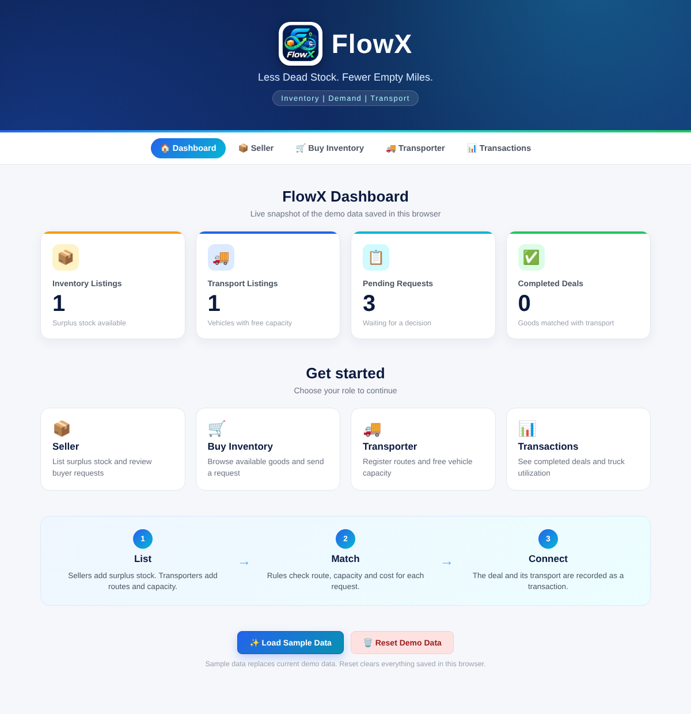
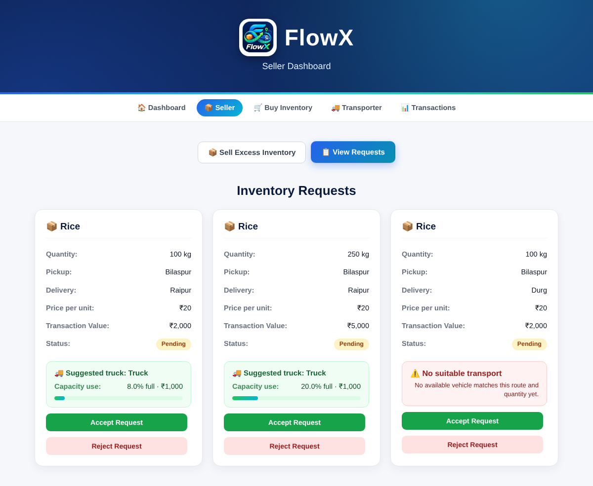
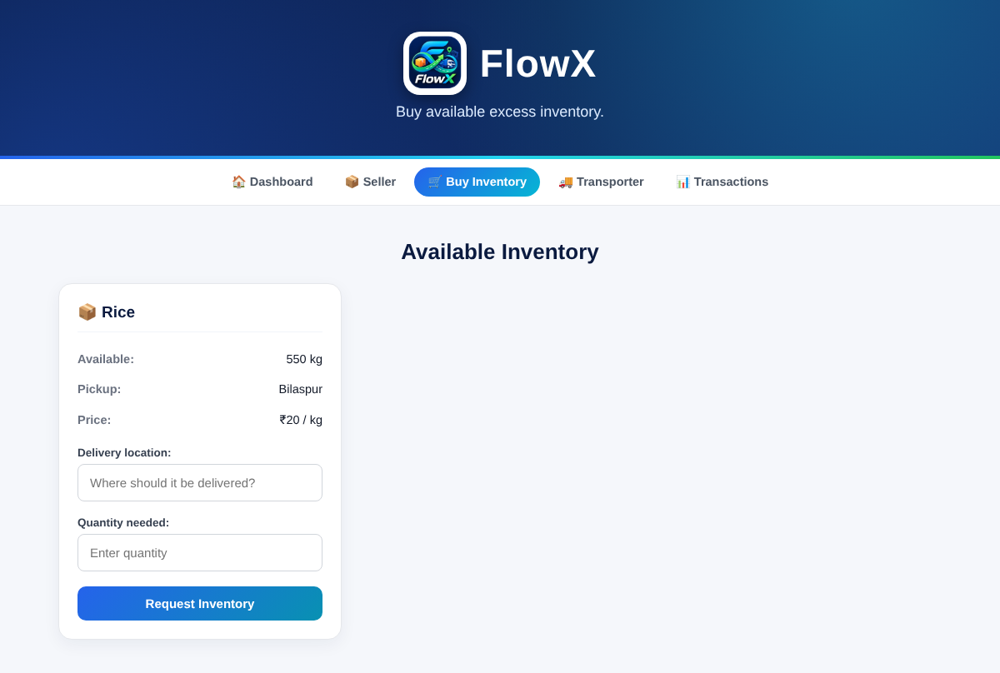
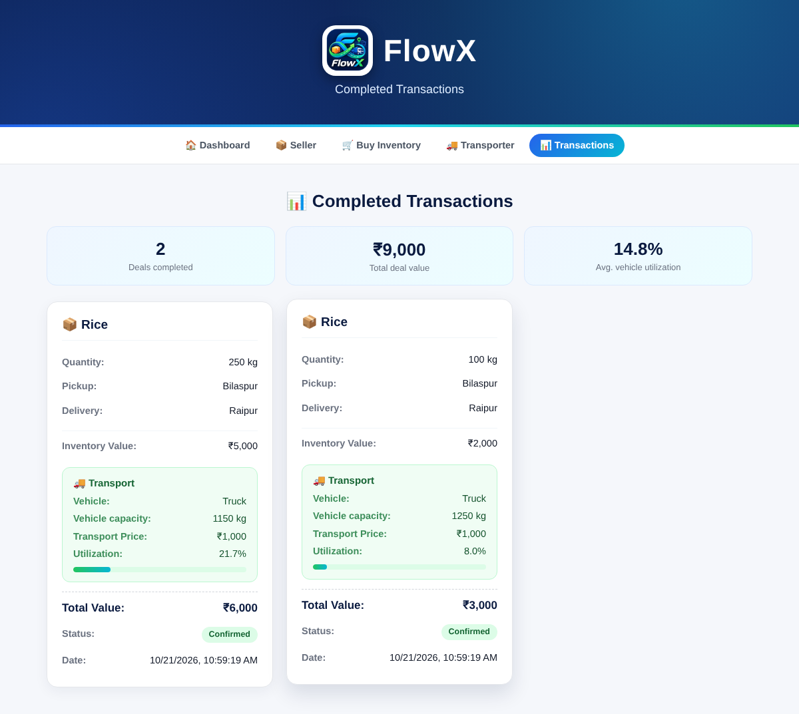

  

<h1 align="center">FlowX</h1>

<b>Less Dead Stock. Fewer Empty Miles.</b> 
Connecting surplus inventory, buyer demand and free truck capacity in one place.

<a href="https://flowx-phi.vercel.app/"><b>▶ Live demo: flowx-phi.vercel.app</b></a>

---

## The problem

- **Dead stock:** businesses hold surplus goods that tie up money and space, and they struggle to find buyers.
- **Empty miles:** trucks often run without a paying load, wasting fuel and vehicle capacity.

Today these two problems are handled separately. FlowX puts them in one workflow.

> Context: the NITI Aayog and RMI report [*Fast Tracking Freight in India* (2021)](https://www.niti.gov.in/sites/default/files/2021-06/FreightReportNationalLevel.pdf)
> states that about 71% of India's freight (tonne-km, 2020) moves by road and reports empty running of 28–43%
> (share of distance travelled by trucks without any load). These figures show the size of the wider problem.
> They are not results produced by FlowX.

## How it works

**List → Match → Connect**

1. **List.** Sellers list surplus stock. Transporters list a route and the free capacity on it.
2. **Match.** A buyer requests goods and a delivery city. FlowX checks the route, the free capacity and the price, and suggests the best truck, which is the fullest truck that fits, then the cheapest. The seller sees this suggestion on every pending request before accepting.
3. **Connect.** When the seller accepts, the stock is reduced, the truck's free capacity is reduced and the deal is recorded with its transport cost and vehicle utilization.

## What the prototype does today

| Feature | Status |
| --- | --- |
| Seller lists surplus inventory | Working |
| Buyer browses stock and sends a request (stock is reserved while requests are pending) | Working |
| Transporter registers a route, capacity and price | Working |
| City suggestions (20 Chhattisgarh cities, any other city can still be typed) | Working |
| Rule-based matching with a **suggested truck preview** on every pending request | Working |
| Accept / reject requests, with stock and capacity updated | Working |
| Transaction records with total value and vehicle utilization | Working |
| In-page notices instead of browser pop-ups | Working |
| Dashboard, sample data loader, reset | Working |

## Screenshots

All screenshots use the built-in **sample data**.

| Dashboard | Seller: requests with suggested trucks |
| --- | --- |
|  |  |

| Buy inventory | Transactions |
| --- | --- |
|  |  |

## Try it

No installation is needed. Open the **[live demo](https://flowx-phi.vercel.app/)**, or download this repository and open `index.html` in a browser.

1. Open the live demo (or `index.html`).
2. On the dashboard, click **✨ Load Sample Data**. It loads 1,000 kg of rice in Bilaspur, a 1,250 kg truck on Bilaspur → Raipur and three pending requests.
3. Open **Seller → View Requests**. The two Raipur requests show a suggested truck. The Durg request shows "No suitable transport" on purpose, because no truck runs that route.
4. Click **Accept Request** on the first two, then open **Transactions**.

The demo saves data in your own browser only, so nothing you enter is shared with other visitors, and clearing your browser data removes it.

## Built with

HTML, CSS and plain JavaScript. Data is stored in the browser's `localStorage`. There is no server.

## Current limitations

This is an early prototype, not a finished product.

- **No shared database.** Data lives in one browser on one device, so it is not shared between users. A real version needs a backend and a database.
- **No accounts or payments.** Anyone can use any page, and no money moves.
- **Exact city names.** Pickup and delivery cities must match the truck's route (capitalization and extra spaces are ignored). There is no "nearby city" logic.
- **Limited unit matching.** kg and tonnes convert into each other. Boxes, litres and units only match a truck that uses the same unit.
- **Simple rules.** Matching looks at route, capacity and price only. It ignores timing, vehicle type and distance, and it does not use AI.
- **No pilot yet.** FlowX has not been tested with real businesses or transporters. Any impact on savings, utilization or emissions is a hypothesis until it is measured.

## Roadmap (planned, not built)

1. Test the workflows with sellers, buyers and transporters in Bilaspur, Raipur and Durg.
2. Add a shared database and user accounts.
3. Improve matching: nearby cities, timing, vehicle type and weight per box or litre.
4. Run a small pilot and measure transactions, utilization and cost against a baseline.

## About

FlowX is built by **Mayank Namdeo**, a first-year B.Tech (Information Technology) student at **CGIT Bilaspur, Chhattisgarh**, for the Seva First Innovation Challenge 2026.
